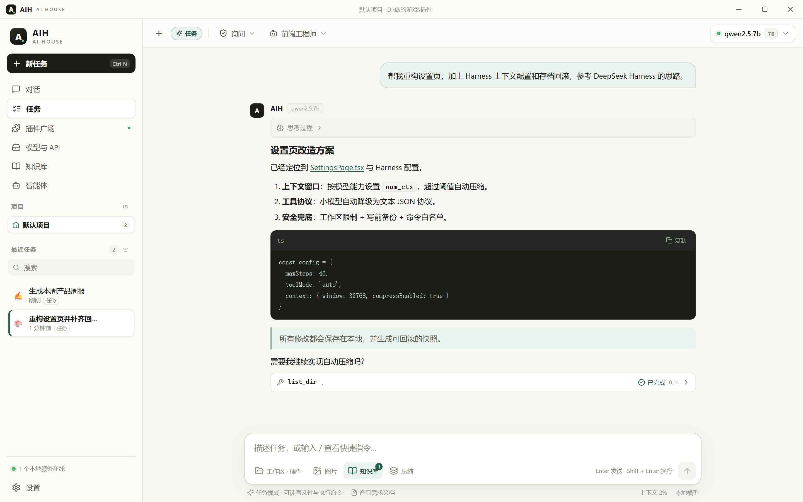
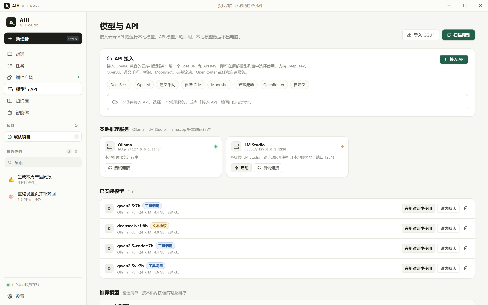
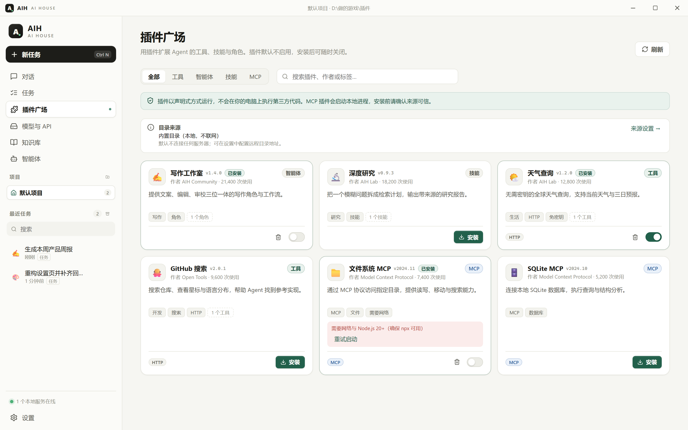
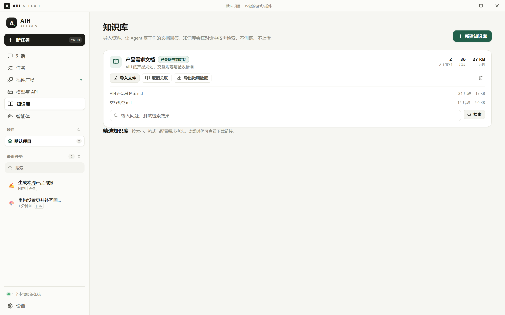
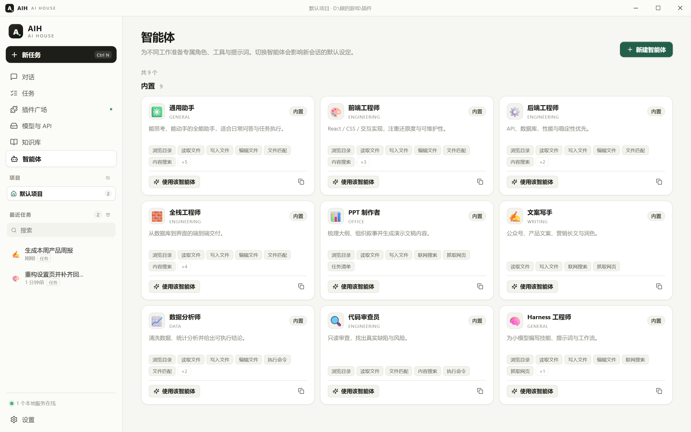
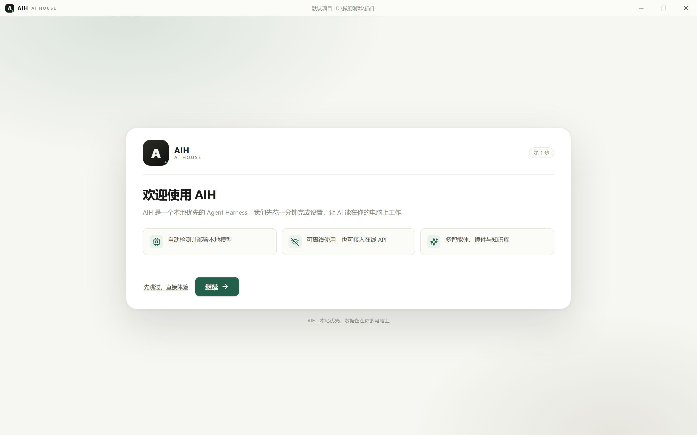

# AIH · AI HOUSE

**Windows 上的本地 AI 工作台：不装 Ollama、不敲命令行，下载就能让本地大模型帮你干活。**

无需预先安装 Ollama，无需配置环境变量：打开 AIH 会自动发现电脑里的模型（Ollama / GGUF / LM Studio），没有模型也能在软件内一键下载并运行；任务模式下 Agent 可以读写工作区文件、执行命令、联网检索、调用知识库与插件。


[](https://github.com/CBXH-use/AIH/actions/workflows/release.yml)
[](https://github.com/CBXH-use/AIH/releases/latest)

**[⬇ 立即下载最新版](https://github.com/CBXH-use/AIH/releases/latest)** · [官网 / 下载页](https://cbxh-use.github.io/AIH/) · [问题反馈](https://github.com/CBXH-use/AIH/issues)



## 下载

| 文件 | 说明 |
| --- | --- |
| `AIH-*-setup.exe` | Windows 安装包，推荐 |
| `AIH-*-win-x64.zip` | 便携版，解压即用 |

系统要求：Windows 10 / 11 x64。

> 安装包暂未进行代码签名。若 Windows SmartScreen 提示“已保护你的电脑”，请点击“更多信息 → 仍要运行”。校验值见对应 Release 说明。

**国内下载慢？** 可以先看 [下载与国内加速说明](docs/download.md)，或用官网下载页的第三方加速链接；也可以用 Gitee 镜像 / 网盘分流。

## 为什么是 AIH

| 你现在的做法 | 在 AIH 里 |
| --- | --- |
| 装 Ollama、敲命令行拉模型 | 打开软件自动发现已有模型；没有就在界面里一键下载并运行 |
| 模型散落在 C 盘、D 盘、Ollama、LM Studio | 自动扫描 Ollama `manifests/blobs`、全盘 GGUF 与 LM Studio 目录 |
| 聊天客户端只能聊天 | 任务模式下能读写文件、执行命令、查知识库、调插件 / MCP |
| 担心数据被上传 | 默认全部留在本机，只有你主动接入的 API 才会联网 |

## 界面

| 模型与 API | 插件广场 |
| --- | --- |
|  |  |

| 知识库 | 智能体 |
| --- | --- |
|  |  |

<details>
<summary>首次启动引导</summary>



</details>

## 功能

- **不依赖 Ollama 检测模型**：直接读取 Ollama 的 `manifests/blobs`，服务未启动也能列出；同时扫描全盘 GGUF 与 LM Studio 模型目录
- **自动定位非 C 盘 Ollama**：通过注册表、PATH、环境变量和多盘常见目录查找，模型目录被移动过也能识别
- **内置 llama.cpp 运行时**：运行时随安装包分发，首次使用本地解压，不依赖 GitHub 网络；没有 Ollama 也能运行 GGUF
- **软件内一键下载**：Qwen2.5 / Qwen3 / DeepSeek R1 / Llama 3.1 / Gemma 2 / Phi-4 / Qwen2.5 Coder 等模型直接下载并启动，ModelScope 失败自动切换 Hugging Face
- **对话与任务双模式**：任务模式下 Agent 可读写工作区文件、执行命令、联网检索、调用知识库与插件
- **安全可控**：高风险操作前请求确认、工作区限制、写文件前备份、本地审计日志
- **多智能体与扩展**：内置多种角色预设，支持插件目录、MCP 与知识库
- **本地优先**：对话、模型与数据默认留在本机；也可以接入 DeepSeek、OpenAI、通义千问、智谱、Moonshot、硅基流动等 OpenAI 兼容 API

## 三步上手

1. 下载并安装 AIH（或解压便携版直接运行 `AIH.exe`）
2. 首次启动自动扫描电脑中的本地模型，选中一个即可开始
3. 没有模型？在「模型与 API」页选择推荐模型，点「一键下载并运行」

模型默认保存在剩余空间最大的磁盘的 `AIH Models` 目录，可在模型页点击「打开模型文件夹」。

> 内置运行时使用 CPU 推理，建议选择 7B / 8B 的 Q4_K_M 模型，16GB 内存起步。如果电脑已安装 Ollama，AIH 会优先使用 Ollama（可 GPU 加速）。

## 安全与隐私

- 默认不联网：模型扫描、对话、知识库索引都在本机完成
- 任务模式默认「询问」权限：删除、改系统设置等高风险操作会先请求确认
- 写文件前自动备份，所有工具调用记录到本地审计日志
- 不接入任何遥测；只有你主动添加的云端 API 会收到对应请求

## 常见问题

<details>
<summary>Windows 提示“已保护你的电脑”怎么办？</summary>

安装包暂未做代码签名，SmartScreen 会拦截未知发布者。点击「更多信息 → 仍要运行」即可；也可以使用便携版 zip。校验值见 Release 说明。
</details>

<details>
<summary>杀毒软件报毒？</summary>

未签名的 Electron 应用偶尔会被误报。请核对 Release 中的 SHA256，并把安装包加入信任；如果仍然担心，可以从源码自行构建。
</details>

<details>
<summary>能完全离线使用吗？</summary>

可以。内置 llama.cpp 运行时和本地模型都在本机运行，首次下载模型之后断网也能对话和干活。只有你接入的云端 API 模型需要联网。
</details>

<details>
<summary>支持 macOS / Linux 吗？</summary>

当前只提供 Windows 10 / 11 x64 版本，其他平台可以按下面的步骤从源码构建尝试。
</details>

## 从源码构建

环境要求：Node.js 20+、Windows 10/11 x64。

```bash
npm install
npm run dev        # 开发模式
npm run typecheck  # 类型检查
npm run build      # 构建渲染层与主进程
npm run dist       # 打包安装包与便携版到 release/
```

`npm run dist` 会自动下载内置 llama.cpp 运行时到 `build/runtime/`（已在本地存在时跳过），然后使用 electron-builder 生成：

- `release/AIH-<version>-setup.exe`
- `release/AIH-<version>-win-x64.zip`

## 发布新版本

推送到 GitHub 后，打标签即可触发 GitHub Actions 自动构建并发布：

```bash
git tag v0.1.2
git push origin v0.1.2
```

工作流：`.github/workflows/release.yml`，产物会自动附加到对应 Release。

## 项目结构

```
electron/          主进程：模型发现、内置运行时、Agent、工具、存储
src/renderer/      React 界面
src/shared/        共享类型与默认配置
scripts/           构建辅助脚本（运行时下载等）
docs/              官网落地页与界面截图
build/             图标与打包资源
```

## 致谢

- [llama.cpp](https://github.com/ggml-org/llama.cpp) — 内置本地推理运行时
- [Ollama](https://ollama.com) / [LM Studio](https://lmstudio.ai) — 本地模型服务
- [ModelScope](https://modelscope.cn) / [Hugging Face](https://huggingface.co) — 模型下载源

## License

[MIT](LICENSE)

---

如果 AIH 对你有帮助，欢迎点一个 ⭐️ Star，这是对项目最大的支持。
